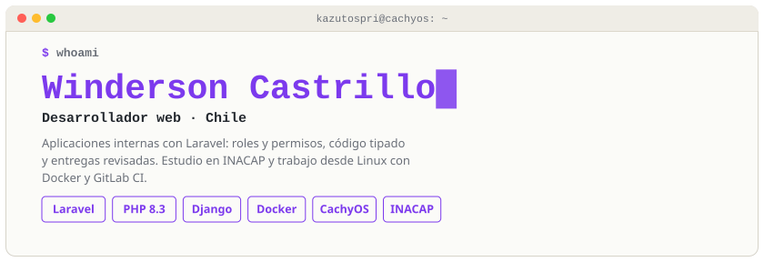
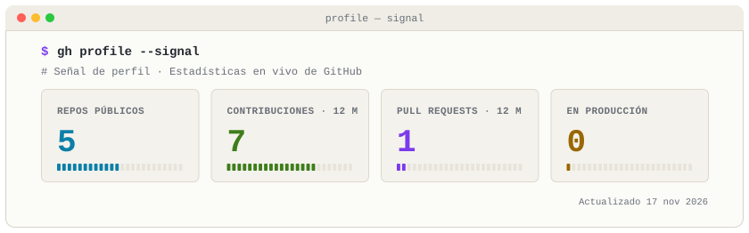
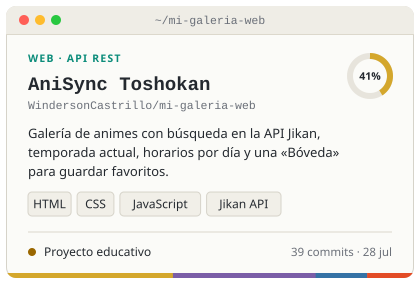
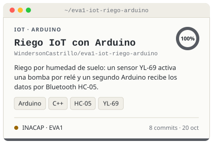
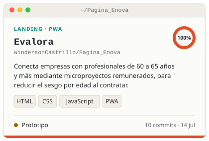
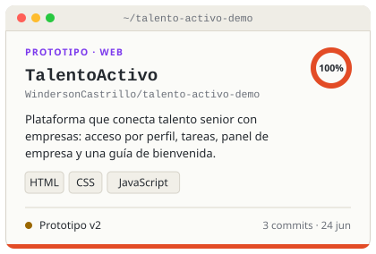
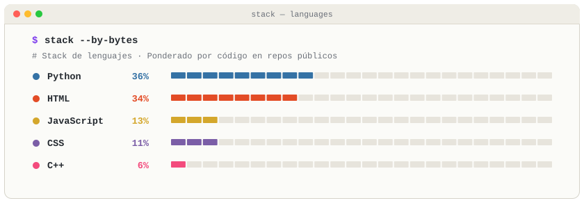
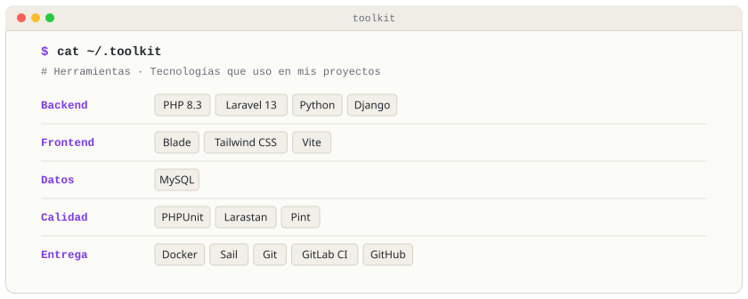
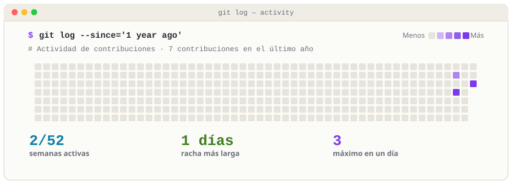

## Trabajo seleccionado

## Herramientas

## Señal de constancia

## Experiencia

<b>Intranet MinCiencia v3</b> · Ministerio de Ciencia, Tecnología, Conocimiento e Innovación Nueva versión de la intranet del ministerio: Laravel 13 y PHP 8.3 con Blade, Tailwind CSS 4 y Vite; roles y permisos con spatie/laravel-permission y login OAuth con Socialite; Larastan, Pint y PHPUnit; Docker con Sail y GitLab CI. El código es del ministerio, por eso el repositorio no es público.

## En desarrollo

<b>ASTERAE</b> · en diseño Tienda online de una prenda, pensada primero para celular. Envíos a EE. UU., sitio bilingüe. Django, Django Admin, Stripe y PayPal.

Fan art de Kirito (<i>Sword Art Online</i>), generado con PixelLab.

Las tarjetas se generan con <a href="scripts/generate.py">scripts/generate.py</a> con datos de la API de GitHub.
